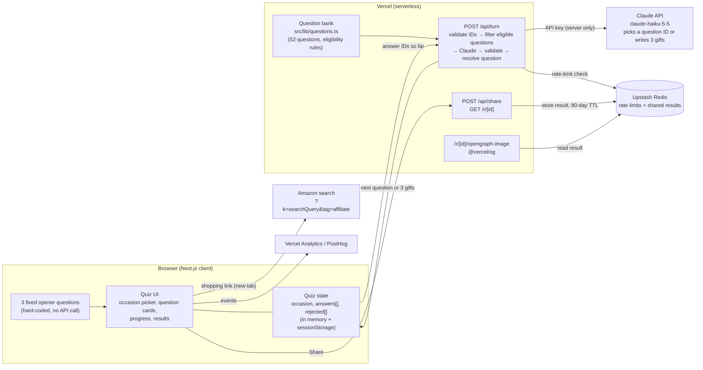

# giftd — Implementation Plan

@Eric · v4

## Overview

A mobile-first web app that asks **up to 10** adaptive questions about the person you're shopping for and recommends 3 gifts. It works year-round, for any occasion.

- **How it plays:** like 20 Questions / Akinator, but shorter. The first 3 questions are fixed. After that, an AI picks each next question from a curated [question bank](giftd%20—%20Question%20Bank.md) based on earlier answers, and stops early once it's confident (never before question 5, never after question 10). The AI writes the gift picks, not the questions.
- **Occasions:** birthday, holiday, anniversary, Valentine's, Mother's/Father's Day, graduation, wedding, housewarming, thank-you, just because. Picked on the landing page (not one of the 10 questions) and defaulted from the calendar, e.g. "Holiday" in December and "Valentine's" in early February.
- **Voice:** funny like a friend who knows the person: specific, recognizable behavior ("Groans when they sit down", "Do they order the same thing every time?"), not hype labels. The jokes go in the questions; options stay plain; the gifts are genuinely good. One voice, no tone toggle. See the bank's Voice section.
- **Output:** 3 picks (safe bet, wildcard, budget option), each with a playful one-line "why", a price range and a shopping link.
- **No accounts:** open the link, play, share the result.
- **Answers are tap-only:** every question has 2–4 options, and there is no skip. Questions that need one include a "none" or "not sure" answer. No free text.
- **Market:** US only (USD, amazon.com).
- **Target session length:** under 2 minutes, about 6–10 taps.

## Architecture and stack

A single Next.js app on Vercel: the browser runs the quiz and holds all quiz state, and one serverless route calls Claude with your API key.



Plain-text version, for viewers that don't render Mermaid:

```
┌──────────── Browser ────────────┐        ┌──────────── Vercel ────────────┐
│ Quiz UI  ◄──►  Quiz state       │        │ Question bank                  │
│  ▲  (occasion, answer IDs)      │        │      │ filter eligible         │
│  │                              │──────► │      ▼                         │
│  │                              │ ◄───── │ POST /api/turn ───────────────►│──► Claude Haiku 5.5
│ 3 fixed openers (no API call)   │        │   (Zod in, Zod out, 1 retry)   │    (picks ID / writes gifts)
│                                 │        │        │                       │
│                                 │        │        ▼                       │
│                                 │        │   Upstash Redis ◄── /api/share │
│ Results ──► Amazon search link  │        │   (rate limit,     /r/[id]     │
│         ──► Share ──────────────│──────► │    shared results) OG image    │
└─────────────────────────────────┘        └────────────────────────────────┘
```

Key properties:

- The browser never sees the API key.
- The quiz loop is **stateless on the server**: every `/api/turn` call carries all answers so far. Nothing is stored unless the user taps Share.
- Upstash Redis is the only stored state (rate limits + shared results). Both are optional for Phase 1.

| Layer | Choice | Notes |
| --- | --- | --- |
| Framework | Next.js (App Router) + TypeScript | |
| UI | Tailwind CSS, Framer Motion | |
| AI | `@anthropic-ai/sdk`, `claude-haiku-5-5` | Structured output via `output_config.format` |
| Validation | Zod | Same schemas for request validation and AI output |
| Hosting | Vercel | Hobby is non-commercial only; see Costs |
| Storage + rate limiting | Upstash Redis (`@upstash/ratelimit`) via the Vercel Marketplace | |
| Share links / OG | Upstash Redis + `@vercel/og` | |
| IDs | `nanoid` | Short share ids |
| Analytics | Vercel Analytics (start) or PostHog (if you want per-question drop-off funnels) | |

## Question engine

### Flow

0. **Occasion** is picked on the landing page (one tap, pre-selected from the date). It isn't counted as a question.
1. **Q1–Q3 are hard-coded in the client.** No API call, so the quiz starts instantly:
   - "Who are we shopping for?" Partner · Relative · Friend · Coworker · Someone else
   - "Which one sounds most like them?" Still has a bedtime *(under 12)* · Communicates mostly in eye rolls *(13–19)* · Still uses a parent's streaming password *(20s)* · Gets genuinely excited about a new vacuum *(30s–40s)* · Groans when they sit down *(50s–60s)* · Signs their texts with their name *(70+)*
   - "What's the budget?" Under $25 · $25–50 · $50–100 · $100–250 · $250+

   The age options are behaviors; the ranges in italics are hidden from users and used only by the server and Claude. Underneath they're still the same age bands, which the eligibility rules depend on. Some ambiguity is intended.
2. **Q4–Q10 come from the [question bank](giftd%20—%20Question%20Bank.md)** (52 hand-written questions with fixed options). Each turn:
   1. The server filters the bank down to **eligible** questions: not yet asked, not excluded by an earlier question, and matching the `when` rules (relationship, age, occasion, follow-up conditions).
   2. Claude sees what's known so far plus the eligible IDs. It returns either `{ action: "ask", questionId }` (the one that best narrows the gift space) or `{ action: "result", gifts }`.
   3. The server checks that the ID is eligible and returns the full question (text and option labels; facts stay on the server) to the client.
3. **The server enforces the bounds** (the model's self-reported confidence is only a hint):
   - fewer than 5 answers → the model may only pick a question
   - 5–9 answers → question or result; return the result when `confidence ≥ 0.8`
   - 10 answers, or no eligible questions left → the model may only return the result
4. **Fallback:** if Claude fails twice on a question turn, the server picks the eligible question with the highest `priority`. The quiz never breaks on a question; only the result call can fail.
5. **"Not it"** on a pick re-rolls just that slot (`mode: "reroll"`), keeping the other two.

Worst case is 7 question calls + 1 result call = **8 Claude calls per quiz**, plus up to a few re-rolls. Question calls are tiny: the output is just an ID.

### Request / response contract

```ts
// POST /api/turn
type Occasion =
  | "birthday" | "holiday" | "anniversary" | "valentines" | "mothers_day" | "fathers_day"
  | "graduation" | "wedding" | "housewarming" | "thank_you" | "just_because";

type TurnRequest = {
  occasion: Occasion;
  answers: Answer[];            // includes the 3 fixed openers; max 10
  mode: "next" | "reroll";      // "reroll" = replace one pick on the results screen
  rejected?: string[];          // gift names the user said "not it" to; max 10, ≤ 80 chars each
  keep?: Gift[];                // reroll only: the picks to keep
  rerollKind?: Gift["kind"];    // reroll only: which slot to replace
};

type Answer = {
  questionId: string;           // must exist in the bank
  optionId: string;             // must be one of that question's options
};

type TurnResponse =
  | {
      type: "question";
      question: { id: string; text: string; options: { id: string; label: string }[] }; // `fact` stays server-side
      index: number;            // 4–10, for the progress bar
    }
  | { type: "result"; resultId: string; gifts: Gift[] };  // exactly 3 on "next", exactly 1 on "reroll"; resultId (nanoid) ties analytics events to this result

// What Claude returns (structured output), before the server resolves it:
type ModelTurn =
  | { action: "ask"; questionId: string; confidence: number }
  | { action: "result"; gifts: Gift[] };

type Gift = {
  name: string;                 // a gift idea, not a brand/product ("Pour-over coffee kit")
  why: string;                  // one playful line, tied to their answers
  priceRange: string;           // e.g. "$25–40"
  kind: "safe" | "wildcard" | "budget";
  category: GiftCategory;       // fixed enum, enforced by the output schema; see Gift sourcing
  searchQuery: string;          // used to build the shopping link
};

type GiftCategory =
  | "kitchen_cooking" | "coffee_tea" | "food_treats" | "drinks_bar"
  | "home_decor" | "home_comfort" | "garden_plants" | "tech_gadgets"
  | "gaming" | "books_reading" | "music_audio" | "art_craft"
  | "diy_tools" | "outdoors_camping" | "fitness_sports" | "wellness_selfcare"
  | "beauty_grooming" | "fashion_accessories" | "jewelry" | "travel_gear"
  | "pets" | "kids_toys" | "kids_learning" | "games_puzzles"
  | "stationery_desk" | "keepsakes_personalized" | "fandom_collectibles" | "car_commute"
  | "experiences" | "subscriptions" | "other";

// Errors: 400 invalid input · 429 rate limited · 502 AI failed twice
```

Zod enforces every limit above on the way in, and the server checks every `questionId` / `optionId` against the bank. Because answers are IDs, **no user-typed text reaches the prompt**: everything Claude reads about the person comes from your own bank. The only client-supplied text is `rejected` and `keep`, which echo Claude's own earlier output and are length-capped.

### What Claude sees each turn

- **System prompt (cached):** the rules below plus the **whole question bank** (ID, text, option labels and facts), about 2–3k tokens. The bank changes only when you deploy, so the cache stays warm.
- **User message (per turn):** the occasion, the answers so far resolved to plain facts (an option's `fact`, else its label: "Age → probably 50s–60s (groans when they sit down)", "Tech → avoids tech"), the eligible question IDs, the answer count, and the allowed actions.

### System prompt rules

**Picking questions**

1. Pick only from the eligible IDs listed in the message.
2. Pick the question whose answer would most change which gifts you'd recommend. Prefer following up on a strong signal over starting a new topic.
3. Report `confidence` (0–1) that you could pick 3 gifts the user would be happy with now.

**Picking gifts**

4. Fit the occasion: an anniversary leans sentimental, a housewarming leans home, a thank-you gift is usually modest.
5. Avoid generic gifts (candles, gift cards, mugs, socks) unless the answers clearly point there.
6. All 3 picks must fit the budget answer; the "budget" pick should be in the lower half of it.
7. Never name a specific brand, product or URL. Return only a gift idea and a search query.
8. Never repeat anything in `rejected`.
9. Picks must be genuinely good gifts a thoughtful friend would choose. Gag gifts only when `humor = gag`, and even then at most one, and it must still be useful or fun to own.
10. Voice: the `why` line is warm and a little funny, like a friend who knows them, and PG. Prefer a specific observation over hype. Tease the situation, never the giver or the recipient. The voice affects only the `why` lines, never the quality of the picks.
11. Tag every pick with the closest `category`.

### Implementation notes

- **Question bank as code:** the bank lives in `src/lib/questions.ts`, typed with the schema in the bank doc. A unit test checks it: unique IDs, 2–4 options, every `requires`/`excludes` points at a real question and option, and every age option has a `fact`.
- **Eligibility filter:** a pure function `eligible(bank, occasion, answers) → Question[]`, unit-tested with a handful of personas (e.g. a 7-year-old never gets `food_drink`; `active_type` only appears after `free_time = active`).
- **Structured output:** use `client.messages.parse()` (or `output_config: { format: … }`) with a JSON schema generated from the Zod schema for `ModelTurn`. On a parse failure, or an ID that isn't eligible, retry once. Then fall back to the highest-priority eligible question (question turns) or return 502 (result turns).
- **Per-turn schema:** send the ask-only schema when there are fewer than 5 answers, the result-only schema at 10 answers or when nothing is eligible, and the union in between. That makes the bounds a hard guarantee rather than a prompt request.
- **Model settings:** `claude-haiku-5-5` with `output_config.effort: "low"`. Haiku 5.5 thinks by default at `medium`, which adds latency and output tokens this task doesn't need. If playtests show picks getting worse, raise the result call to `medium`. Optionally A/B `claude-sonnet-5-5` for the result call only (about $0.01 more per quiz).
- **Prompt caching:** put `cache_control` on the system prompt (rules + bank). Keep it byte-identical between calls: no timestamps, and a stable bank order. Check `usage.cache_read_input_tokens` to confirm it's working.
- **Latency target:** under 1.5 s per question; the output is just an ID. Show a skeleton card while waiting. No streaming needed.
- **Shopping link:** `https://www.amazon.com/s?k=${encodeURIComponent(searchQuery)}&tag=${AFFILIATE_TAG}`. The AI can't link to products that don't exist, and encoding makes the URL injection-safe.
- **Back / edit answer:** the client truncates `answers` to that point and calls `/api/turn` again. Later questions may come out differently, which is fine.
- **Persistence:** mirror quiz state into `sessionStorage` so a refresh or accidental back-swipe doesn't lose progress.
- **Microcopy:** buttons, loading and error states use the same voice ("Consulting the gift gods…", "Not it", "Shop this"). Keep a single `src/lib/copy.ts` so the voice stays consistent and is easy to tweak.

## Gift sourcing

Gifts stay **AI-generated**. There's no hand-made catalog. Standardized questions mean every result is tied to a clean, structured answer profile, so you can measure which picks work for which kinds of people and feed that back later.

**Built now (Phase 1–4), so the data exists from day one:**

- `category` on every `Gift`, from the fixed `GiftCategory` enum, enforced by the output schema.
- `resultId` on every result, so clicks can be joined to the picks and answers that produced them.
- `PROMPT_VERSION` constant, sent with every analytics event, so prompt changes can be compared.
- Anonymous analytics (no IP, no PII; answers are bank IDs):
  - `quiz_complete`: `resultId`, occasion, answer IDs, and for each pick its `name`, `kind` and `category`
  - `shop_click`: `resultId`, pick `name`, `kind`, `category`
  - `reroll`: `resultId`, the rejected pick's `name` and `category`

**Later (post-launch, once there are a few thousand completed quizzes):**

1. **Find what works.** Group results by a simple profile signature (relationship + age + occasion + 1–2 strong answers like `free_time`) and rank gift ideas and categories by shop-click rate, minus reroll rate.
2. **Proven picks list.** Review the top performers by hand and save them in `src/lib/proven-picks.ts`, keyed by profile signature. The list grows from data, not from guessing.
3. **Give it to Claude as inspiration, not a menu.** On the result call, add the 3–5 matching proven picks to the user message ("Ideas that landed well for similar people: …"). Claude can still go beyond them. This puts a floor under quality without making results repetitive.
4. **Steer variety.** If one category dominates a profile (every dad gets `diy_tools`), add a prompt nudge or rule.
5. **A/B it** with `PROMPT_VERSION`: proven picks on vs. off, compare shop-click rate.

The same aggregates can power the public "most popular picks per occasion" SEO page.

## Build plan

Four phases. Each phase ends with something you can play.

**Phase 1 — Core loop**

- [x] Create Next.js app (App Router, TypeScript, Tailwind)
- [ ] Deploy to Vercel
- [ ] Get an Anthropic API key, add it to `.env.local` and as a Vercel env var (`ANTHROPIC_API_KEY`), set a monthly spend limit in the Console
- [x] Port the [question bank](giftd%20—%20Question%20Bank.md) to `src/lib/questions.ts` with its validation test
- [x] Eligibility filter + unit tests
- [x] Zod schemas for `TurnRequest`, `TurnResponse`, `ModelTurn`, `Gift`, `GiftCategory` (shared by client and server)
- [x] Build `/api/turn`: system prompt with the bank, per-turn schema, structured output, ID validation, one retry, priority fallback
- [x] Quiz screen: occasion picker, hard-coded openers, question card, tap options (no skip), "Question 4 of up to 10" progress bar. Results shown as plain cards until Phase 2
- [x] Persona playtest script (`npm run playtest`), not yet run: 20 personas across different occasions (e.g. "dad, 60s, golf, has everything, $50–100, Father's Day"). A second Claude call answers as the persona by picking option IDs. Log the questions chosen, question count, picks, categories and cost. Use it to tune the prompt and find gaps in the bank. Also check that the playful voice never leaks into weaker or gimmicky picks.
- [ ] Hand-play 10 quizzes for real people you know

**Phase 2 — Results**

- [x] Visual design: "Glow" theme (blurred color glows, frosted-glass answers and cards, Manrope). Dark by default, light when the system asks for it. Mocks: the design canvas's Final page
- [x] Results screen with the 3 picks, "why" lines and price ranges
- [x] Shopping links built from `searchQuery` (plain search links until the affiliate tag exists)
- [x] "Not it" on each pick: `mode: "reroll"` replaces only that slot and remembers rejected ideas
- [x] Back button: returns to the previous question with the old answer highlighted
- [x] `sessionStorage` persistence: a refresh restores the current question or the results; Start over clears it
- [x] Loading states (picked answer stays highlighted while the next turn loads) and CSS fade-in transitions; Framer Motion only if it's still wanted
- [x] Error states: 429 ("Too many quizzes, try again in a bit"), 502 (retry button)

**Phase 3 — Shareability**

- [x] `/api/share` stores `{ occasion, relationship, answers, gifts }` in Redis under a `nanoid(8)` with a 90-day TTL; result page at `/r/[id]`. Gifts are signed (HMAC) when generated, so shares can only contain real giftd picks. Needs `GIFTD_SHARE_SECRET` and Upstash env vars in production; in-memory store in development
- [x] OG images with `next/og`: the shared result card, plus a default one for the home page (Manrope, Glow look)
- [x] "Ask someone who knows them better" link: a fresh quiz with the occasion prefilled and a "Someone wants your help" line. Relationship is not prefilled, because it's relative to the person answering (my dad is my mom's partner)
- [x] Copy pass: all microcopy in `src/lib/copy.ts` in the playful voice
- [x] Landing page: occasion picker + one big Start button

*Lowest priority if something has to give: "send to someone" → OG image. Keep the basic share link.*

**Phase 4 — Harden and launch**

- [ ] Rate limiting per IP with Upstash: 60 `/api/turn` calls per hour (≈ 6–7 full quizzes with re-rolls) and 10 shares per hour
- [ ] Analytics events: `quiz_start` (with occasion), `question_answered` (with `questionId`, `optionId`, index), `quiz_complete`, `reroll`, `shop_click`, `share`, with the gift fields listed in Gift sourcing. Per-question drop-off (users who quit on that question) and shop-click rates are how you'll prune and improve the bank; per-pick clicks feed the proven-picks list later.
- [ ] Apply for Amazon Associates; add affiliate disclosure and a privacy note
- [ ] Upgrade Vercel to Pro once affiliate links go live
- [ ] Buy domain, final mobile QA on iOS Safari and Android Chrome
- [ ] Launch: Product Hunt, Reddit gift subreddits (check each sub's self-promo rules), a TikTok/Reels demo of the quiz. Time later pushes to the gift-heavy dates (Valentine's, Mother's/Father's Day, graduation season, holidays).

## Costs and guardrails

**AI cost: about $0.003–0.005 per quiz** on Haiku 5.5 ($0.10 / $0.50 per million input / output tokens, [pricing](https://platform.claude.com/docs/en/about-claude/pricing)). That assumes up to 8 calls per quiz at about 1,500–2,500 input tokens and about 300 output tokens each (JSON plus low-effort thinking). Prompt caching lowers the input side further.

| Volume | Claude API / month |
| --- | --- |
| 100 quizzes | ~$0.50 |
| 10,000 quizzes | ~$40–50 |
| 100,000 quizzes | ~$400–500 (affiliate revenue should cover this; revisit at that point) |

| Item | Monthly cost |
| --- | --- |
| Claude API | see above |
| Vercel | $0 on Hobby while building; **$20/mo Pro once affiliate links are live** (Hobby forbids commercial use) |
| Upstash Redis | $0 on the free tier at launch scale |
| Domain | ~$10–15 / year |

Guardrails, all in place before launch:

- API key only on the server; never sent to the browser
- Monthly spend limit in the Anthropic Console as the hard cap
- Per-IP rate limit on `/api/turn` and `/api/share`
- Answers are bank IDs, validated server-side, so no free text reaches the prompt
- Zod caps on request size: ≤ 10 answers, ≤ 10 rejected ideas of ≤ 80 chars. With no server-side sessions, this is what bounds the cost of a single call.
- Short prompts: send only resolved question/answer pairs, not prior AI explanations
- `max_tokens` capped on every call (2,000 for question turns, 4,000 for gift turns; thinking tokens count toward it, and at Haiku output prices the cap costs at most $0.002)
- No storage of quiz answers unless the user shares; no IP or PII in logs or shared results

## Risks and open questions

| Risk | Mitigation |
| --- | --- |
| Picks feel generic | "Avoid generic" rule, "not it" re-rolls, persona playtests, optional Sonnet for the result call, proven picks post-launch |
| Silly voice makes picks gimmicky | Prompt rule 9 (good gifts first, gag only when asked), playtest checks |
| Playful copy confuses people or dates | Every joke answer has a hidden plain-meaning `fact` for Claude; no memes or slang; watch per-question drop-off and answer spread |
| No skip forces bad answers | Include a "none" / "not sure" answer where one is needed; persona playtests flag questions with no good fit |
| Age behaviors put people in the wrong band | Accepted for the mystery; Claude treats age as approximate; kid options are hard to pick for adults, so the age rules stay safe |
| 10 questions isn't enough signal | Fixed openers cover the big three; persona tests measure pick quality at 5, 7 and 10 questions |
| The bank misses what matters for some people | Persona playtests to find gaps; drop-off analytics; adding a question is a code change with no prompt rewrite |
| Claude picks an ineligible ID or fails | ID validation + one retry + priority fallback, so question turns can't break |
| Picks ignore the budget or occasion | Explicit prompt rules, plus playtest checks that every `priceRange` fits and picks suit the occasion |
| Slow turns feel laggy | Low effort, fixed openers with no wait, skeleton UI; measure p90 latency in playtests |
| AI returns broken JSON | Structured output + Zod validation + one retry |
| Bot traffic drains the API budget | Rate limit + Zod size caps + Console spend cap |
| Amazon Associates approval is slow (needs 3 qualifying sales in 180 days) | Launch with plain search links if needed; add the tag once approved |
| Vercel Hobby terms vs. affiliate revenue | Move to Pro before affiliate links go live |
| Traffic spikes around holidays | Rate limits and spend cap hold; raise the Console limit ahead of known peaks |

Decided:

- [x] Name: **giftd**
- [x] Year-round, any occasion
- [x] US only at launch (USD, amazon.com)
- [x] Tap-only answers, no free text
- [x] Questions come from a curated bank; Claude picks the next question and writes the gifts
- [x] Gifts stay AI-generated; category + click logging now, proven-picks inspiration later
- [x] One voice across the app, observational humor rather than hype; no tone toggle

Open questions:

- [ ] Domain: check giftd.com / giftd.app / getgiftd.com availability
- [ ] Question bank review: playful wording, the age behaviors, and the gaps listed in the bank's review notes

After launch: occasion reminders ("Mom's birthday is in 2 weeks, want to take the quiz?"), which would need opt-in email and is the first reason to add accounts. Also a public page of the most popular picks per occasion for SEO, built from shared results, aggregated and anonymized.
